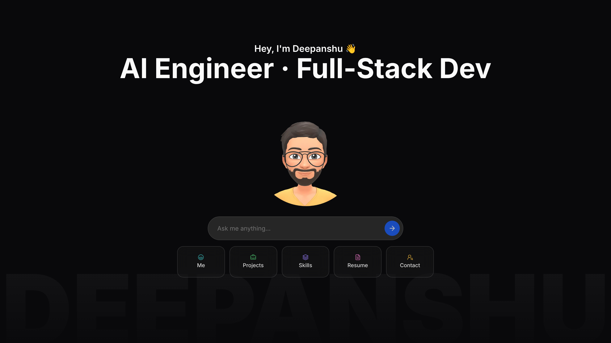

# Deepanshu Saini — AI Portfolio 🤖✨

Hey, I'm **Deepanshu** — a full-stack + AI developer from Yamunanagar, India, currently a MERN Stack Developer at AllHeart Web Pvt Ltd.

Instead of a static page, this portfolio is a conversation: ask a question and my AI avatar answers about my work, projects, skills and experience.

➡️ **Try it now:** [portfolio.deepxdev.com](https://portfolio.deepxdev.com)

## 👇 What can you ask?

- 🧠 **Recruiter?** Ask about my stack, experience and what I've shipped
- 💻 **Dev?** Dive into MyAuth, the AI Notification System, GitIssueHunt and more
- 📬 **Want to work together?** Ask how to reach me

## 🚀 How to run

### Prerequisites
- **Node.js** (v18 or higher)
- **pnpm** package manager
- **Google Gemini API key** (for AI chat functionality)
- **GitHub token** (for the GitHub stars button)

### Setup
1. **Clone the repository**
   ```bash
   git clone https://github.com/deepanshu2711/portfolio.git
   cd portfolio
   ```

2. **Install dependencies**
   ```bash
   pnpm install
   ```

3. **Environment variables**
   Create a `.env` file in the root directory:
   ```env
   GOOGLE_GENERATIVE_AI_API_KEY=your_gemini_api_key_here
   GITHUB_TOKEN=your_github_token_here
   ```

4. **Run the development server**
   ```bash
   pnpm dev
   ```

5. **Open your browser**
   Navigate to `http://localhost:3000`

### Getting your **tokens**
- **Gemini API Key**: Get it from [aistudio.google.com](https://aistudio.google.com/app/apikey)
- **GitHub Token**: Generate one at [github.com/settings/tokens](https://github.com/settings/personal-access-tokens) with repo access

---

Built on top of [toukoum/portfolio](https://github.com/toukoum/portfolio) by Raphael Giraud.
